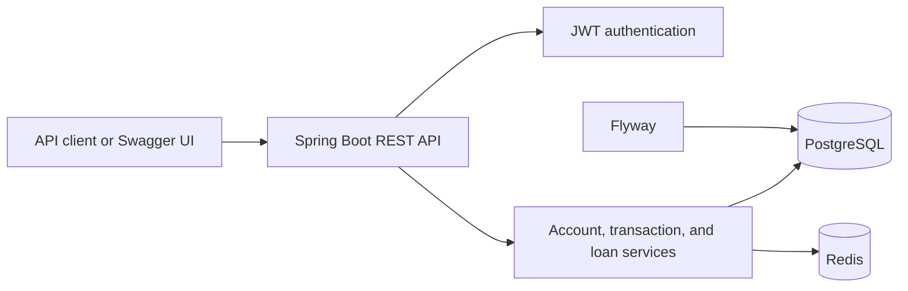
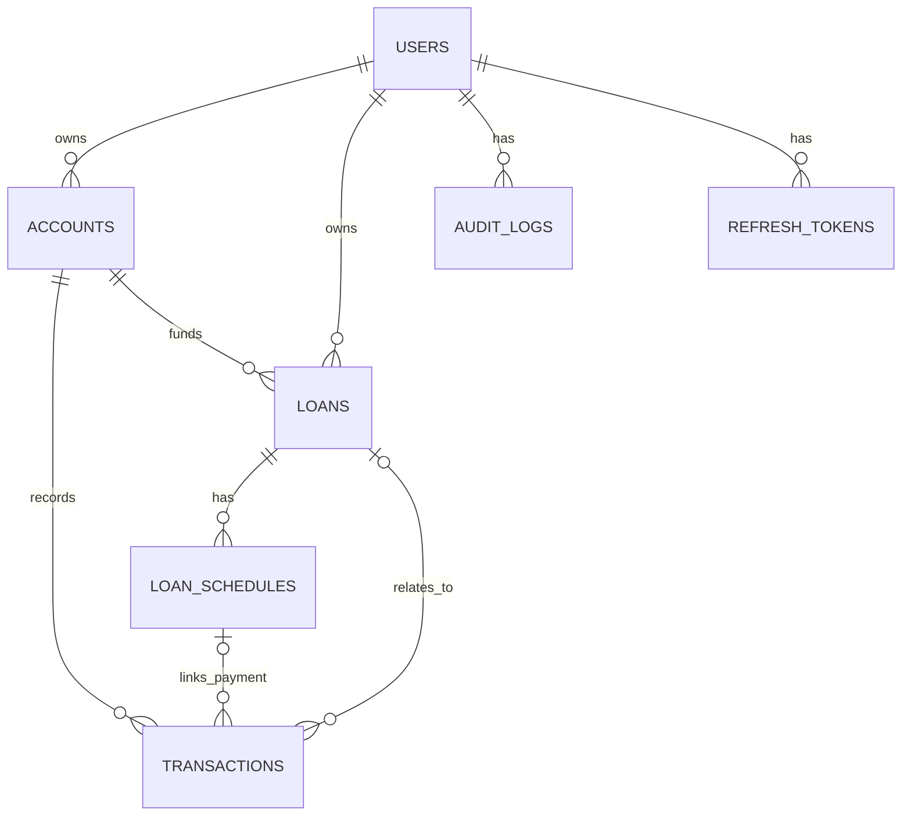

# Personal Finance and Loan Management API

This Spring Boot API tracks account balances, transfers, loans, and installment payments. PostgreSQL stores the ledger and loan schedules. Redis caches loan schedules and monthly summaries.

## Run locally

Use Docker with Compose v2 and an OpenSSL installation. Run the following setup block in Bash, or Git Bash on Windows. It creates `.env` from [the template](.env.example) and generates a local RSA key pair.

```sh
if [ ! -e .env ]; then
  (
    set -euo pipefail
    umask 077
    key_dir=$(mktemp -d)
    trap 'rm -f "$key_dir/key.pem" "$key_dir/env"; rmdir "$key_dir"' EXIT
    openssl genpkey -algorithm RSA -pkeyopt rsa_keygen_bits:2048 -out "$key_dir/key.pem"
    private_key=$(openssl pkcs8 -topk8 -nocrypt -in "$key_dir/key.pem" -outform DER | openssl base64 -A)
    public_key=$(openssl pkey -in "$key_dir/key.pem" -pubout -outform DER | openssl base64 -A)
    grep -v '^JWT_' .env.example > "$key_dir/env"
    printf 'JWT_PRIVATE_KEY=%s\nJWT_PUBLIC_KEY=%s\n' "$private_key" "$public_key" >> "$key_dir/env"
    mv "$key_dir/env" .env
  )
fi
```

Set a local `DB_PASSWORD` in `.env` before the first startup. Keep the database name in `DB_URL` the same as `POSTGRES_DB`. `DB_USERNAME` and `DB_PASSWORD` configure PostgreSQL and the application. `REDIS_HOST` and `REDIS_PORT` point to the Compose Redis service. The application expects a Base64 PKCS#8 private key and a Base64 X.509 public key. Store local keys in the Git-ignored `.env` file.

```sh
docker compose up --build -d
docker compose ps
```

Open [Swagger UI](http://localhost:8080/swagger-ui/index.html) or [the OpenAPI JSON](http://localhost:8080/v3/api-docs). The application starts after PostgreSQL and Redis pass their health checks. Flyway applies the database migrations on startup. `docker compose down` stops the stack and preserves its data volume.

## Build and test

Use JDK 21 and a running Docker engine. The Maven wrapper downloads Maven on the first run. The integration tests start their own PostgreSQL 18 and Redis 7 containers, apply Flyway migrations to the test database, and generate an RSA key pair in memory. The command requires no `.env` file or personal credentials. On first use, Docker may download the test images.

```powershell
.\mvnw.cmd --batch-mode --no-transfer-progress clean verify
```

```sh
sh ./mvnw --batch-mode --no-transfer-progress clean verify
```

Lombok is a Maven `provided` dependency and is explicitly configured as a compiler annotation processor. The runnable JAR is generated under `target/`.

Use the commands above for local verification. The [GitHub Actions workflow](.github/workflows/build.yml) is ready for future use. Once the project is on GitHub with Actions enabled, pushes and pull requests will run the same Maven build and tests. The first hosted run is pending.

## Example workflow

The following PowerShell example registers a disposable user against the running local API, uses the returned JWT, and makes a loan payment.

```powershell
$baseUrl = 'http://localhost:8080/api/v1'
$runId = [Guid]::NewGuid().ToString('N')
$password = "local-$runId"

function Send-Json($path, $body, $headers = @{}) {
    Invoke-RestMethod -Method Post -Uri "$baseUrl$path" -ContentType 'application/json' `
        -Headers $headers -Body ($body | ConvertTo-Json -Compress)
}

$registration = Send-Json '/auth/register' @{
    fullName = 'Local demo'; email = "demo-$runId@example.com"
    password = $password; confirmPassword = $password
}
$authHeaders = @{ Authorization = "Bearer $($registration.token)" }
$checking = Send-Json '/accounts' @{ accountName = 'Checking'; accountType = 'CHECKING'; currency = 'PHP' } $authHeaders
$savings = Send-Json '/accounts' @{ accountName = 'Savings'; accountType = 'SAVINGS'; currency = 'PHP' } $authHeaders

$null = Send-Json '/transactions/deposit' @{
    accountId = $checking.id; amount = 1000; category = 'Salary'; idempotencyKey = "$runId-deposit"
} $authHeaders
$null = Send-Json '/transactions/transfer' @{
    fromAccountId = $checking.id; toAccountId = $savings.id; amount = 100; idempotencyKey = "$runId-transfer"
} $authHeaders

$loan = Send-Json '/loans' @{
    accountId = $checking.id; loanName = 'Demo loan'; principal = 250; annualRate = 5
    termMonths = 2; disbursedAt = (Get-Date -Format 'yyyy-MM-dd')
} $authHeaders
$null = Send-Json "/loans/$($loan.loanId)/simulate?paymentNumber=1&extraAmount=10" @{} $authHeaders
Send-Json "/loans/$($loan.loanId)/schedule/1/pay" @{ idempotencyKey = "$runId-payment" } $authHeaders
```

Use a fresh idempotency key for each new deposit, withdrawal, transfer, or installment payment. Reuse the key and original payload when retrying the same request.

## Financial rules

- New accounts, loans, and money movements use PHP. Historical USD and JPY records remain readable. Transfers require accounts with matching currencies.
- Deposits, withdrawals, and transfers accept positive amounts with up to 15 digits before the decimal point and two decimal places. Trailing zeros are accepted.
- Loan schedules use monthly installments and four-decimal storage. Interest uses the outstanding principal and the monthly rate. The last installment adjusts for rounding to clear the remaining principal. Installments must be paid in order. A simulation estimates the effect of extra payment and leaves the schedule intact.
- Monthly summaries use UTC calendar months. The service records a ledger for the accounts it manages.
- Installment payments created before Flyway V8 lack the installment link needed for a safe retry. Reusing an idempotency key from one of those payments returns HTTP `409 Conflict`.

## Architecture




